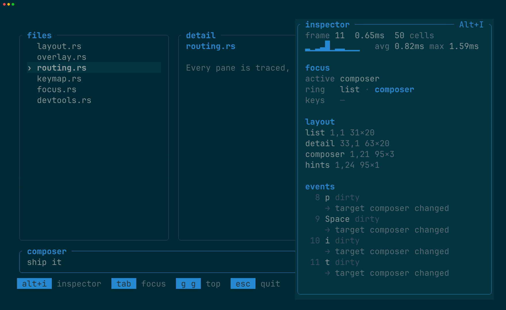
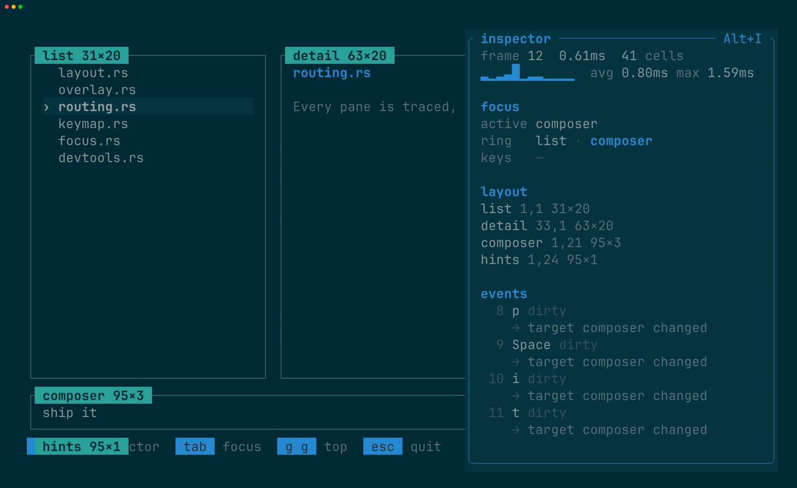

# Devtools inspector

The inspector draws what a frame is doing over the frame itself: the screen
rects your views were laid out into, which surface owns input and how the last
event was routed, a pending key sequence, how long the frame took to paint and
how many cells it changed, and a log of recent events.

<p align="center">
  
</p>

## Turning it on

The inspector is behind the `devtools` feature, so a release build compiles none
of it:

```toml
[features]
devtools = ["tuika/devtools"]
```

Attach one to the runner and keep a clone for the application:

```rust,ignore
use tuika::devtools::Inspector;
use tuika::prelude::*;

let inspector = Inspector::new();
let runner = Runner::new(RunnerConfig::default()).with_inspector(inspector.clone());
let mut app = App::new(inspector);
runner.run(&theme, &mut app)?;
```

`alt+i` cycles it: the panel, then the panel with layout outlines, then hidden.
The runner gives the inspector first refusal of every event, so that chord never
reaches your application; pick another with `Inspector::toggle_key` if it
collides with one of yours. `AsyncRunner::with_inspector` is the same for the
async runner.

With nothing else, the runner fills in the frame line (paint time, damaged
cells, and a sparkline of recent paints) and the event log (each event with the
`UpdateResult` your `update` returned). Pointer moves, drags, and scroll bursts
fold into one line with a count; keys and clicks stay one line each.

## Telling it what only your application knows

The rest is state your application owns, so you hand it over where you already
have it.

**Layout.** Wrap a view in `trace` and its rect is listed in the panel and, in
outline mode, framed and labelled on screen:

```rust,ignore
let list = inspector.trace("list", SelectList::new(rows, &self.list));
```

<p align="center">
  
</p>

**Focus and routing.** After an event is routed, record the delivery and the
focus state; the route is attached to that event's log line:

```rust,ignore
let delivery = router.finish();
inspector.record_route(&delivery);
inspector.record_focus(&self.focus);
```

The panel shows the active surface, an overlay that holds input, and the focus
ring in tab order. See [input routing](routing.md) for the router itself.

**Pending keys.** `inspector.record_keymap(&self.keys)` shows a half-typed
sequence such as `g …`, which is otherwise invisible until it completes or
dead-ends. See the [keymap guide](keymap.md).

## Driving your own loop

Without a runner, call its half yourself: `inspector.handle(&event)` before
routing (it returns `true` for the toggle chord), `inspector.log_event(&event,
result)` after, `inspector.begin_frame()` before painting the tree,
`inspector.paint(buffer, area, &theme)` after it, and
`inspector.record_frame(paint_time, terminal.last_damage())` once the frame has
been flushed.

## What it leaves out

A paste is logged by its length, never its text. A debugging overlay is exactly
what ends up in a screenshot or a shared screen, and a paste is where secrets
travel.

## Try it

```bash
cargo run --example devtools --features devtools
```

The example starts with the panel open; pass `--outlines` to start in outline
mode or `--hidden` to start with it closed.
