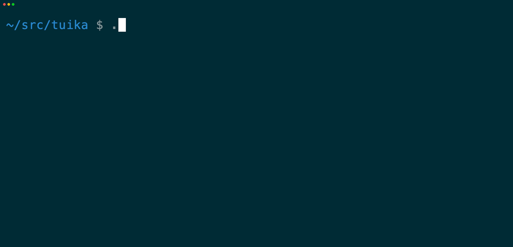
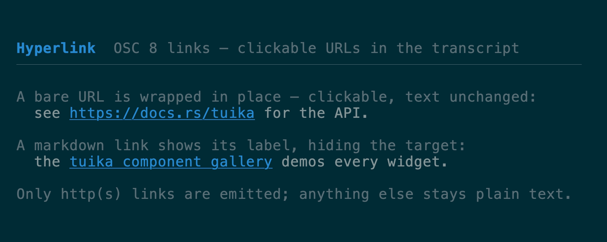
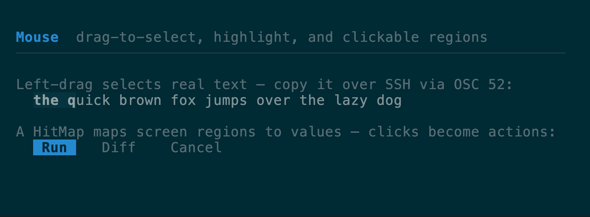
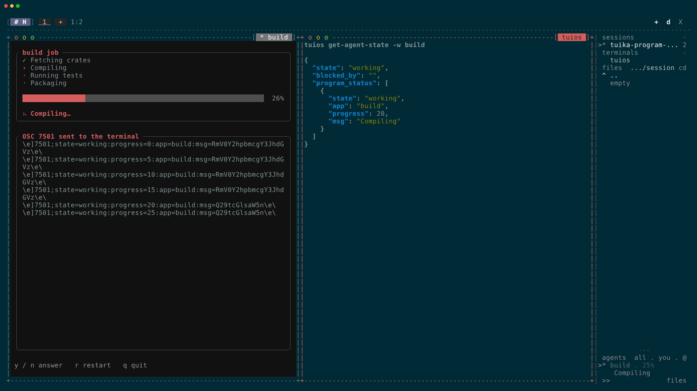
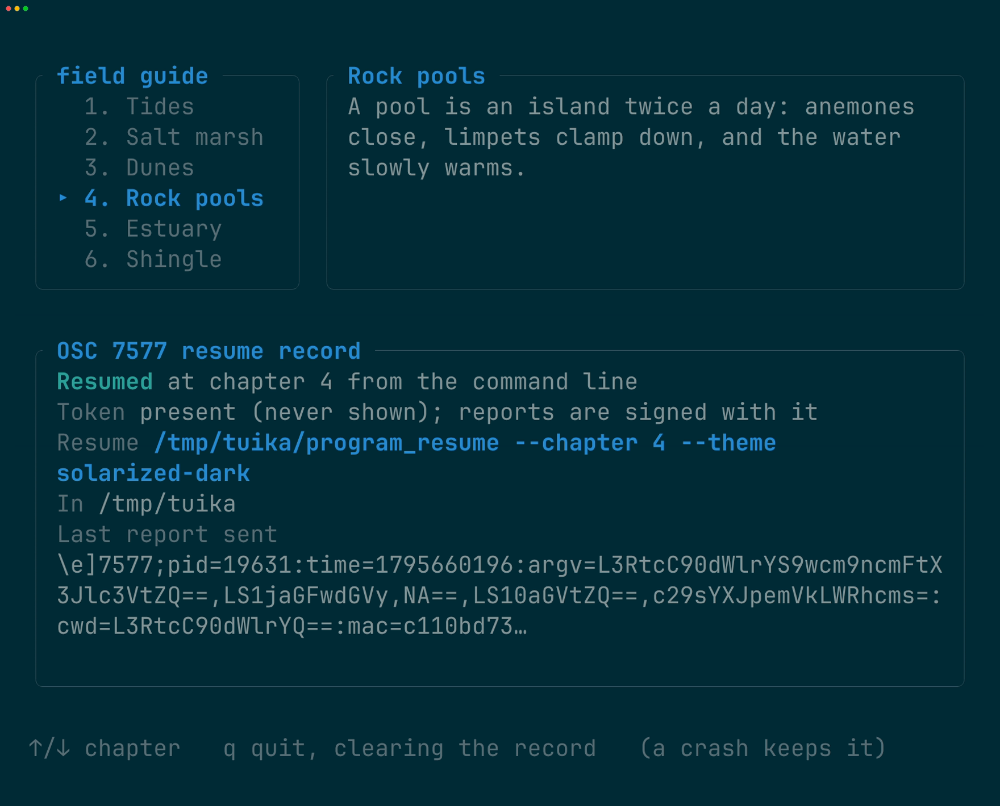
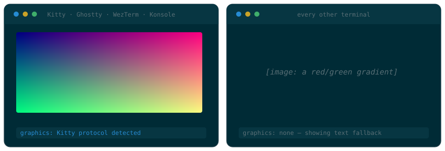

# Terminal features

Cross-cutting terminal capabilities that sit outside the [component
gallery](components.md): the *out-of-band* escape sequences tuika speaks to the
terminal itself — clickable links, native progress, the system clipboard — and
the mouse model that turns pointer input into selections and clicks.

These are terminal features, not widgets. Where a component paints cells,
several of these emit an OSC (Operating System Command) sequence the terminal
interprets directly. That has one consequence worth stating up front: a
terminal that understands the sequence acts on it; one that does not silently
ignores the unknown OSC, so the feature degrades to plain text or a no-op
rather than leaking escape codes onto the screen.

## Capabilities

`Capabilities` is the one place to ask what the terminal can do —
`graphics` (an `ImageSupport`, the Images section below), `hyperlinks`,
`clipboard`, `progress`, and `truecolor`.
[API](https://docs.rs/tuika/latest/tuika/term/capabilities/index.html)

```rust
use tuika::term::capabilities::Capabilities;

let caps = Capabilities::from_env();   // instant, no terminal I/O
if caps.supports_images() { /* … */ }
```

Two tiers. `Capabilities::from_env()` is an **advisory** guess from `TERM`,
`TERM_PROGRAM`, `COLORTERM`, `KITTY_WINDOW_ID`, and the Ghostty marker — instant,
never blocks. Because the OSC features above degrade harmlessly, you emit them
regardless; the flag only decides whether to *show an affordance* (a "copy" hint,
a link underline) the terminal can't act on, so those flags lean conservative.
OSC 8 detection also recognizes VS Code, Zed, mintty, Konsole, and
`VTE_VERSION >= 5202`. Under tmux / GNU Screen the outer terminal's environment
does not prove OSC 8 passthrough, so the hyperlink flag stays conservative.

For accuracy — mainly to confirm **Sixel**, which has no reliable environment
signal — `Capabilities::query(timeout)` also does a **Device Attributes** probe:
it writes `DA1_REQUEST` (`ESC [ c`), reads the reply, and upgrades `graphics`
when the terminal reports Sixel (DA1 feature `4`). Call it once at startup, in
raw mode, before the event loop reads stdin (Unix ttys only; elsewhere it is just
`from_env`). The pieces are also exposed standalone — `DA1_REQUEST` and
`DeviceAttributes::parse` — so a host with its own read strategy can do the
round-trip itself. Kitty and iTerm2 keep their reliable environment detection
(DA1 doesn't report them).

## Color depth

A theme written in hex is correct on every terminal. `Runner` and `AsyncRunner`
detect how many colors the terminal has and map each cell's truecolor values to
the nearest one it can show before writing them — the 6×6×6 cube and gray ramp of
the 256-color palette, or the sixteen ANSI colors on a Linux console. Only the
bytes on the wire change; the frame, and every test that reads it, keeps the
theme's own colors.
[API](https://docs.rs/tuika/latest/tuika/term/capabilities/enum.ColorDepth.html)

```rust
use tuika::{Runner, RunnerConfig};
use tuika::term::capabilities::ColorDepth;

// Detected by default; override when the host knows better.
let runner = Runner::new(RunnerConfig::default()).with_color_depth(ColorDepth::Ansi256);
```

Detection is `ColorDepth::from_env()`, and it reduces only on positive evidence:
16 colors for terminals known to be limited (`linux`, `vt…`, `ansi`,
`…-16color`), 256 for Apple Terminal, and true color for everything else —
including an SSH session, where `COLORTERM` is usually not forwarded. A host driving its own backend opts in with
`CrosstermBackend::with_color_depth`, and `Color::downsample` is the mapping on
its own.

## Inheriting the terminal's colors

The user already chose a palette — in Ghostty, kitty, WezTerm, wherever they
work. An application can adopt it instead of imposing its own, so it looks like
it belongs in the terminal it was launched from.
[API](https://docs.rs/tuika/latest/tuika/term/palette/index.html)

**This never happens on its own.** tuika ships a default theme and changes it for
nobody; inheriting is something a host asks for, explicitly, with one of the two
calls below. Nothing here runs unless you call it.

There are two ways, and they trade accuracy against cost.

### Without asking the terminal anything

`themes::TERMINAL` is a `const Theme` whose every slot is `Color::Reset` or a
`Color::Indexed` ANSI slot, so the terminal resolves the palette itself:

```rust
use tuika::themes;

let theme = themes::TERMINAL;   // that's it — no I/O, no timeout, no failure
```

It cannot be wrong about the user's setup and cannot fail — it works on a
terminal that answers nothing at all, and on a light background as readily as a
dark one. The limit is that ANSI has no tone *between* two slots, so tuika's
raised and faint roles collapse: `surface` and the code background come out as
the plain background, and `dim`, `border`, and `muted` all land on bright black.
Panels and rules read flatter than a designed palette.

### By asking

For real 24-bit values — and therefore real in-between tones — ask the terminal
what its colors are and derive a theme from the answer:

```rust
use std::time::Duration;
use tuika::{Theme, themes};
use tuika::term::capabilities::Capabilities;

// In raw mode, at startup, before the event loop reads stdin:
let (caps, palette) = Capabilities::query_with_palette(Duration::from_millis(100));
let theme = Theme::from_terminal(&palette).unwrap_or(themes::TERMINAL);
```

The queries are the xterm ones: `OSC 10` for the default foreground, `OSC 11` for
the background, `OSC 4` per ANSI entry. Ghostty, kitty, WezTerm, foot, alacritty,
contour, iTerm2, and xterm answer them; others answer nothing, and
`from_terminal` returns `None` so you fall back.

`Theme::from_terminal` uses the reported foreground and background **verbatim** —
that is the whole point — and derives everything the terminal has no notion of:

- The in-between tones (`surface`, `muted`, `dim`, `border`, the code
  background) are blends between the foreground and the background, so a light
  palette and a dark one both work without a special case.
- The hues (`accent`, and the syntax roles) come from the ANSI palette, taking
  the bright half on a dark background and the normal half on a light one. Blue
  leads and cyan follows: a terminal reports no notion of a *brand* color, so
  tuika takes the conventional interactive hue rather than inventing one.
- Every derived color is held to a minimum contrast against the background. A
  user's palette is free to put two colors on top of each other; a UI built out
  of it is not.

Any ANSI slot the terminal does not report falls back to xterm's default for that
slot, so a terminal that answers `OSC 10` and `OSC 11` but not `OSC 4` still
yields a complete theme.

### Why the query is fenced

A terminal that does not implement `OSC 11` does not say so — it stays quiet, and
a reader cannot tell *not yet* from *never*. So tuika appends the Device
Attributes request (`DA1_REQUEST`), which every terminal answers, as a **fence**:
once its reply arrives, every color reply that was ever coming has arrived. The
probe therefore costs one round-trip rather than one timeout, and because that is
the same request the capability probe already makes,
`Capabilities::query_with_palette` answers both questions at once.

Call it **once at startup, in raw mode, before the event loop reads stdin** — the
replies arrive on stdin, and a running event loop would deliver them to your
application as keystrokes. The read stops exactly at the fence, so input typed
behind the replies is left for the application.

The [`inherit`](../examples/inherit.rs) example does all of this end to end —
including `cargo run --example inherit -- --probe`, which prints what your
terminal actually answers without taking over the screen.

## Screen modes: alternate screen & split footer

`ScreenMode` decides which part of the terminal a frame owns. The default takes
the whole window on the alternate buffer while leaving mouse handling native.
`ScreenMode::split_footer(rows)`
instead reserves rows at the bottom of the *main* screen and leaves everything
above as the terminal's own scrollback — the shell prompt, the wheel, mouse
selection, and the output the app publishes, which is still there after it
exits.

<p align="center">
  
</p>

Because the footer owns the cursor, a host publishes through tuika instead of
`println!`: `Scrollback` is a cloneable, `Send + Sync` queue for background
producers, and `screen::publish_block` commits a view straight from a host's own
render loop. Either way a block is rendered once and handed over — it is the
terminal's content afterwards, not a frame tuika will repaint.

A chat or log footer usually shows the newest lines live and publishes whatever
no longer fits. Publishing scrolls the terminal, so it has to happen before the
footer is painted, yet how many rows the footer shows is decided by the footer's
own layout. `probe::resolve_layout` answers that first: it lays the tree out
without painting, so a `RectProbe` around the transcript region reports its
height, the host publishes the overflow, and then paints the same tree over the
rows it kept.

```rust,ignore
let rows = RectProbe::new();
tuika::probe::resolve_layout(area, &ctx, &footer(&app, &rows), &[]);
app.publish_overflow(terminal, rows.rect().height)?; // calls screen::publish_block
let rows = RectProbe::new();
terminal.draw(|f| tuika::paint_with_context(f.buffer_mut(), f.area(), &ctx, &footer(&app, &rows), &[]))?;
```

```rust,ignore
use tuika::prelude::*;

let runner = Runner::new(RunnerConfig {
    tick_rate: Duration::from_millis(80),
    screen_mode: ScreenMode::split_footer(5),
});
let scrollback = runner.scrollback();
scrollback.write(|_width| element(Text::raw("build finished in 12 ms")));
```

Run it with `cargo run --example split_footer`, or see a whole coding-agent UI
in the mode with `cargo run --example codex -- --split-footer`.
Press `+` / `-` in the split-footer example to change its height. Both runners
expose `footer_height() -> Live<u16>`: setting it wakes the loop, applies the
height before publishing or painting, and preserves the backend and scrollback.
Zero clamps to one row; a short terminal limits the visible height. Hosts with
their own loop call `Terminal::set_footer_height` on an inline viewport.

## Hyperlinks (OSC 8)

Turn a bare `http(s)` URL — or a markdown `[label](url)` whose visible text is
not the URL — into a real clickable link, without changing the visible text. A
cell buffer can't carry a link target — a `Cell` is one grapheme plus a
style — so tuika emits the link by writing the OSC 8 sequence around the run
(via [`HyperlinkBackend`] scanning arbitrary rendered output, or
[`apply_buffer_links`] for destinations retained by `Paragraph` and the
markdown renderer).
[API](https://docs.rs/tuika/latest/tuika/term/hyperlink/index.html)



The entry points cover both components and lower-level output:

- `Paragraph` — wrapped plain prose links bare web URLs by default, including
  URLs split across rows. Configure it with `Paragraph::link_policy`; `Text`,
  `Wrap`, `CodeBlock`, and `Console` stay literal.

- `hyperlink::encode(url, text)` — the pure encoder. Returns `text` wrapped in the OSC 8
  sequence, or `text` unchanged when `url` isn't a safe web URL. No I/O.
- `write_line(out, line)` — serialize a `Line` (colors, modifiers, and
  OSC 8 links) straight to a writer, so a host can push a transcript line to
  scrollback with live links instead of routing it through the cell buffer.
- `HyperlinkBackend` — a `Backend` wrapper that scans drawn cell runs
  for URLs and wraps just those in OSC 8, so links work inside the normal render
  path too. When disabled it's a zero-cost pass-through.
- `markdown::to_linked_lines` + `apply_buffer_links` — the markdown renderer
  preserves `[label](url)` destinations as [`BufferLink`]s through wrapping;
  after painting the lines, `apply_buffer_links` embeds OSC 8 into the boundary
  cells (ForcedWidth) so a label that is not itself a URL stays clickable with
  the terminal's native modifier. `Paragraph` uses the same buffer-link path
  for bare URLs. Configure schemes with `LinkPolicy`, `Markdown::link_policy`,
  or `Paragraph::link_policy`.

The three lower-level emitters have policy-aware forms — `encode_with`,
`write_line_with`, and `HyperlinkBackend::with_policy` — taking a `LinkPolicy`
so the host chooses which schemes are linked. The default (`LinkPolicy::WEB`) is `http(s)`-only;
`LinkPolicy::WEB.with_mailto()` also links `mailto:` addresses.
`LinkPolicy::NONE` skips emission entirely.

OSC 8 activation belongs to the terminal emulator, and tuika leaves mouse
handling native by default in both screen modes. This is required for terminal
modifier-click activation: enabling mouse capture routes mouse events to the
application instead, disabling the emulator's native link activation,
selection, and scrolling. A host should opt into capture only when it needs
application pointer/wheel events. Full-screen hosts that capture pointer motion can use
`write_pointer_shape(..., PointerShape::Pointer)` on link hover; it emits OSC 22
and should be paired with `PointerShape::Default` on hover exit and shutdown.
Other shapes are `Text`, `EwResize`, `NsResize`, `Grab`, `Grabbing`, and
`NotAllowed`, for editors, splitters, drag handles, and unavailable actions.

```rust
use tuika::term::hyperlink::{encode, is_web_url};

// Pure encoder — safe to unit-test, no terminal needed.
let link = encode("https://docs.rs/tuika", "the tuika docs");

// A bare URL a host would style and hand to `write_line` as a link run.
assert!(is_web_url("https://docs.rs/tuika"));
```

The emitted bytes (`ST` is the string terminator `ESC \`):

```text
ESC ] 8 ; ; https://docs.rs/tuika ST   the tuika docs   ESC ] 8 ; ; ST
```

**Supported terminals:** Ghostty, iTerm2, WezTerm, Kitty, recent VTE-based
terminals. Others render the visible text unchanged.

**Limits & safety.** The scheme allowlist is the safety boundary: by default
only `http://` and `https://` are accepted, and a host that opts into `mailto:`
gets it sanitized separately — the query (`?cc=`, `?body=`, …) is dropped so a
click can't be steered into pre-filled headers. Every accepted target has its
control characters stripped (including the `ESC`/`BEL` that could break out of
the sequence), so a crafted URL can't escape the OSC. Under tmux, passthrough
must be enabled: `set -g allow-passthrough on`.

## Mouse: selection, highlight & clicks

Tuika leaves mouse handling to the terminal by default, preserving native OSC 8
activation, selection, and scrolling. Capture is explicit through
`ScreenMode::with_mouse_capture`, `MouseCapture::Enabled`, or
`AltScreen::enter_with_mouse_capture`.

Once an app opts into capture, the terminal stops handling links and selection.
`Runner` and `AsyncRunner` restore selection over the final cell
frame: a plain left drag highlights text, a same-cell double click selects a
word, a third selects the panel row, and releasing copies through OSC 52.
Dragging after the second or third press extends by whole words or rows.
Selection is *per panel* — a drag
that starts inside a bordered `Boxed` stays inside it, wrapping at that panel's
edges rather than streaming across the panes beside it, so copying a sidebar
entry never drags in the editor next to it. Inside a scrolled view (`Scroll`,
`Viewport`, `ItemScroll`) the selection is anchored to *content rows* instead of
screen rows: it stays on the same text while the view scrolls, scrolling back
shows it where it was made, and a drag with the wheel turning underneath it can
span any number of screens. Rows the drag passed over are remembered as they are
painted, so the copy includes them after they scroll away. A custom scrolling
view opts in by calling `RenderCtx::record_scrolled_content` from its `render`.
Wheel events continue to reach the application. Return
`UpdateResult::Consumed` for a handled gesture that needs no repaint, or
`UpdateResult::Dirty` for one that does; either result keeps draggable controls
from also becoming a text selection. `with_text_selection(false)` disables the
runner default.

The `mouse` module exposes the same primitives for hosts with their own loop —
selection, copy, and hit-testing — from tuika's enriched event model
(`MouseKind` carries `Down`/`Up`/`Drag`, `Moved`, and scroll, with
`shift`/`ctrl`/`alt`).
[API](https://docs.rs/tuika/latest/tuika/mouse/index.html)



- `SelectionState` turns a left-button `Down → Drag → Up` gesture into a
  `SelectionRange`, and a same-cell double click selects the word under the
  pointer; a third selects the confined row. Call `resolve(buffer, area)` after
  rendering to resolve word/row boundaries and selection updates;
  `selected_text(buffer, area, range)` then reads the selected text
  back out of the rendered buffer (wide glyphs intact) and `mouse::paint_selection(buffer,
  area, range, style)` paints it in. `handle_with_clock` accepts a host `Clock`
  for deterministic gesture timing; `handle` uses `SystemClock`. `confine(Some(rect))`
  restricts a gesture to one panel — positions clamp into the rect, and `region()`
  reports it back so `resolve`, `selected_text`, and `paint_selection` can be
  given the same bounds as their `area`.
- `ContentSelection` is the same gesture kept in content space, for a host
  that scrolls its own view. Each call takes the frame's `ContentWindow` (the
  screen rect and the content row and column at its top-left); after painting,
  `resolve` handles word and row clicks, `capture` remembers the selected rows
  so they can still be copied once scrolled away, `paint` highlights the
  visible part, and `text()` returns the selection.
- `ctrl_click_url(event, buffer, area)` is an application-side fallback for a
  host that opted into capture. It returns the URL under a Ctrl+left-button
  release: first an OSC 8 target embedded in the cell run (labeled markdown
  links after `apply_buffer_links`), then a visible bare `http(s)://` run. The
  host remains responsible for opening it. Because capture disables terminal
  link activation and selection, prefer native OSC 8 unless the application
  genuinely needs mouse events.
- `HitMap<T>` maps screen rects to values (a button, a link, a row); the
  last-pushed match wins, so children and overlays registered after their
  parents take precedence. `ClickTracker` turns a same-cell `Down`/`Up` into a
  `Click` and lets an intervening drag cancel it.

```rust
use tuika::mouse::{SelectionState, selected_text};

let mut sel = SelectionState::new();   // held by the host across frames
sel.handle(&mouse);                    // feed each mouse event
if let Some(range) = sel.range() {
    let text = selected_text(&buffer, area, range);
    // …copy `text` to the clipboard (see below)
}
```

Selection integrates with the clipboard feature below: the text a drag selects
is exactly what `clipboard::write` copies. **Shift-drag** is deliberately left to
the terminal so its native selection still works as an escape hatch.

## System clipboard (OSC 52)

Copy text to the system clipboard by writing an OSC 52 sequence — the *terminal*
does the copy, so there's no platform clipboard library and it works over SSH.
That makes it the natural partner to a mouse selection.
[API](https://docs.rs/tuika/latest/tuika/term/clipboard/index.html)

- `clipboard::encode(text)` — pure encoder; returns the sequence, or `None` when `text` is
  empty or exceeds `MAX_LEN`.
- `clipboard::write(out, text)` — encode and write in one step, returning whether
  a sequence was emitted. It detects tmux (`TMUX`) / GNU Screen (`STY`) and
  applies their DCS passthrough framing.
- `encode_for(text, Multiplexer)` / `write_for(out, text, Multiplexer)` — use an
  explicit transport, including `Multiplexer::None` for an unwrapped OSC.

```rust
use tuika::term::clipboard;

let mut out = std::io::stdout();
let copied = clipboard::write(&mut out, "selected text")?;   // Ok(true) when emitted
```

The emitted bytes are the base64-encoded payload, terminated by `ST` (`ESC \`):

```text
ESC ] 52 ; c ; <base64-of-text> ST
```

**Supported terminals:** Ghostty, iTerm2 (with clipboard writes enabled),
WezTerm, Kitty, recent VTE, xterm.

**Limits.** Terminals cap the sequence near 100 000 bytes, so a single copy is
bounded at `MAX_LEN` (74 994 bytes); longer text is refused rather than sent
truncated — a truncated clipboard is worse than a failed copy. tmux passthrough
needs `set -g allow-passthrough on`. GNU Screen uses BEL to terminate the inner
OSC and splits it across bounded DCS payloads. Custom or nested transports
should choose their framing explicitly; the writer does not negotiate terminal
clipboard permissions.

## Native progress (OSC 9;4)

Drive the terminal's *own* progress indicator — a bar across the window in
Ghostty, the taskbar in Windows Terminal and ConEmu. It's fully out-of-band: it
moves no cursor and paints no cells, so it works in both the inline and
full-screen renderers and composes with an in-grid
[`ProgressBar`](components/motion.md#progressbar).
[API](https://docs.rs/tuika/latest/tuika/term/progress/struct.TerminalProgress.html)

`TerminalProgress` owns the indicator and clears it on drop, so a dropped or
panicking session never leaves a stuck bar in the taskbar. Its methods map to
the indicator states: `percent` (normal), `error`, `indeterminate`, and
`clear`.

```rust
use tuika::term::progress::TerminalProgress;

let mut progress = TerminalProgress::new();
progress.percent(60);        // 60% on the terminal's own bar
// progress.indeterminate(); // busy, percent ignored
// progress.error(60);       // error state at 60%
// …dropping `progress` clears the indicator.
```

The emitted bytes (`state` is 0–4, `percent` is 0–100; terminated by `BEL`):

```text
ESC ] 9 ; 4 ; <state> ; <percent> BEL
```

**Supported terminals:** Ghostty (bar across the top of the window), Windows
Terminal and ConEmu (taskbar), WezTerm, Konsole, mintty. Others swallow the
unknown OSC. Writes are best-effort — a failed progress write never disrupts the
session.

## Program status (OSC 7501)

Tell the terminal what the program is doing — idle, working (with optional
0–100 progress), blocked on the user, done, or errored — so it can show that
beside the pane instead of a spinner nobody can read. This is Mitchell
Hashimoto's [Program Status Protocol](https://www.superlogical.com/rex/docs/build/program-status),
an open terminal protocol: any terminal or multiplexer can read it, and the
rest ignore it. Like OSC 9;4 it is out-of-band and works in every screen mode.
[API](https://docs.rs/tuika/latest/tuika/term/program_status/index.html)

The host decides the state; tuika only encodes and validates. Build a `Report`,
then `write` it to the terminal:

```rust
use tuika::term::program_status::{self, BlockKind, Report, State};

let mut out = std::io::stdout();
let working = Report::new(State::Working)
    .app("build")
    .progress(40)
    .msg("Compiling");
let _ = program_status::write(&mut out, &working);

let asking = Report::new(State::Blocked)
    .kind(BlockKind::Question)
    .app("build")
    .msg("Publish the build?");
let _ = program_status::write(&mut out, &asking);

let _ = program_status::write(&mut out, &Report::new(State::Done).app("build"));
let _ = program_status::write(&mut out, &Report::clear(None)); // on exit
```

The emitted bytes (`title` and `msg` are base64 of UTF-8 text):

```text
ESC ] 7501 ; state=working:progress=40:app=build:msg=Q29tcGlsaW5n ESC \
```

Records form a tree through `.id("build/test")`; no id addresses the root
record. A terminal drops an invalid report whole, so `encode` returns `None`
and `write` emits nothing for one tuika can tell is invalid: a malformed or
over-long id (more than 128 bytes or 8 segments), an `app` outside
`[A-Za-z0-9_.+-]{1,32}`, a control character (C0, DEL, or C1) in `title` or
`msg`, or a text over the spec's length limits. `kind` without `blocked` and
`progress` outside `working`/`blocked` are dropped rather than rejected.
`encode_query()` builds the `ESC ] 7501 ; ? ESC \` feature query.

### Let the runner own the protocol

A program usually has one status, not a stream of reports. Give it to the
runner instead and it handles the protocol around that value:

```rust,no_run
use tuika::prelude::*;
use tuika::term::program_status::{Report, State};

let runner = Runner::new(RunnerConfig::default()).with_native_progress(true);
let status = runner.program_status();
status.set(Some(Report::new(State::Working).app("build").progress(40)));
// … later, from `update` or any thread:
status.set(Some(Report::new(State::Done).app("build")));
```

- A report goes out only when the value changes, however often the loop runs.
  Setting it from another thread wakes the loop.
- On exit the record is cleared only if it was last `working` or `blocked`. A
  `done` or `error` record is left for the user to find, which is what the
  spec asks for. Sending `clear` on exit would wipe it.
- When the user cancels, set `report.cancelled()`: the spec's `idle`, keeping
  the record's `app` and `title`.
- `with_native_progress(true)` drives OSC 9;4 from the same value (working is
  a bar or a busy indicator, blocked a warning, error an error), so the two
  indicators never disagree. The bar is hidden when the run ends.

A host with its own loop gets the same behavior from `StatusReporter`.

The [`program_status`](../examples/program_status.rs) example walks a scripted
build through every state and prints the exact reports it sends; run it in a
terminal that reads OSC 7501 to watch the pane's status follow along. The
recording below uses [tuios](https://tuios.dev/docs/program-status), one such
terminal.



**Supported terminals:** any that implement the Program Status Protocol, such
as [tuios](https://tuios.dev/docs/program-status). Others swallow the unknown
OSC.

## Program resume (OSC 7577)

Tell the terminal which command would bring the program back — the same
document, the same view, the same project — so a terminal that restores its
panes after a restart relaunches *that* instead of a bare shell. This is the
[Program Resume Protocol](https://www.superlogical.com/rex/docs/build/program-resume),
a companion to program status from the same family of open protocols. The
terminal never replies; whether and when to resume is entirely its call.
[API](https://docs.rs/tuika/latest/tuika/term/program_resume/index.html)

Unlike every other escape on this page, a resume report is **signed**. The
command it carries is one the terminal may later run, so a report must not be
forgeable by whatever else can write to the pty — a `cat` of a hostile file,
a remote shell, a child process. The terminal puts a random per-pty secret in
`OSC7577_TOKEN`, and every report carries `mac = sha256(body ":" token)`. That
variable is also the feature test: no token, no report, and tuika will not
write one without it.

`Reporter` owns the token and the current command. Create it once, update it
whenever the state that defines "where the user was" changes, and clear it
when the user quits:

```rust
use tuika::term::program_resume::{Report, Reporter};

let mut out = std::io::stdout();
let mut resume = Reporter::from_env(); // None: the terminal doesn't offer resume

// Whenever the open document changes (unchanged commands are not re-sent):
if let Some(resume) = &mut resume {
    let exe = std::env::current_exe().unwrap();
    let report = Report::resume([exe.to_str().unwrap(), "--open", "notes.md"])
        .cwd(std::env::current_dir().unwrap());
    let _ = resume.update(&mut out, &report);
}

// When the *user* quits — not on SIGHUP, SIGTERM, or a lost terminal:
if let Some(resume) = &mut resume {
    let _ = resume.clear(&mut out);
}
```

The emitted bytes (each argument is base64 of UTF-8, so spaces, `;`, and
`$(…)` stay inside one argument and are never shell source):

```text
ESC ] 7577 ; pid=74877:time=1795543200:argv=bGF6eWdpdA==:cwd=L2hvbWUvdXNlci9zcmMvcHJvamVjdA==:mac=35cb9098…58e1 ESC \
```

What the spec asks of a program, and where tuika does it for you:

- **Fresh, not replayed.** A report is valid for about a minute, so `pid` and
  `time` are stamped when it is sent. `Reporter::refresh` re-sends the current
  command with a new time; call it after `SIGCONT`, or after a child you ran in
  the foreground exits.
- **Only what a terminal would accept.** Element 0 must be a bare name (found
  on `PATH` at resume time) or an absolute path — prefer the absolute path
  from `current_exe()`. `cwd` must be absolute. Control characters, more than
  64 arguments, or a sequence over 2048 bytes make `encode` fail rather than
  emit something the terminal would discard. When a new command cannot be
  sent, `Reporter` sends `clear` so the old one is not resumed by mistake.
- **No environment.** The protocol carries no environment variables, so
  anything the command depends on — a theme, a profile, a cluster context —
  belongs in `argv`.
- **The token stays private.** `Token`'s `Debug` is redacted, and
  `scrub_env(&mut command)` removes `OSC7577_TOKEN` from every child process
  you spawn, which the spec requires: a child holding it could report in your
  name.

`verify` is the terminal's half: strict parsing, the MAC and time checks, and
the spec's split between *ignored* (unauthenticated — touch nothing) and
*rejected* (authentic but invalid — drop the owner's records). Use it in your
own tests to assert that what you send would actually be accepted.

The [`program_resume`](../examples/program_resume.rs) example is a small reader
that reports `[<its own path>, --chapter, N]` as you move between chapters. Run
it in a terminal that restores panes, restart the terminal, and it reopens on
the same chapter and says it was resumed. Anywhere else, give it a token to see
the reports it sends:

```sh
OSC7577_TOKEN=local-demo-token-0123456789 cargo run --example program_resume
```



**Supported terminals:** any that implement the Program Resume Protocol, such
as [Rex](https://www.superlogical.com/rex). Others never set `OSC7577_TOKEN`,
so nothing is sent.

## Images (Kitty, iTerm2 & Sixel graphics protocols)

Paint real pixels — an avatar, a chart, a rendered diagram — over the cells a
view reserves for them, using the **Kitty**, **iTerm2**, or **Sixel** graphics
protocol, whichever the terminal speaks.
[API](https://docs.rs/tuika/latest/tuika/term/image/index.html)



Unlike the other demos, this one is generated from the real render rather than
recorded — VHS captures through xterm.js, which doesn't implement the Kitty
graphics protocol, so it can't show the pixels. The picture above is the actual
RGBA the component transmits; the fallback panel is the exact placeholder string
it paints.

Images are the one out-of-band feature that does **not** degrade harmlessly on
its own: a terminal that can't read the graphics escape may paint the payload as
garbage rather than swallowing it. So this is the only feature gated on real
capability detection — `ImageSupport::detect()` reads the environment (`TERM`,
`TERM_PROGRAM`, `KITTY_WINDOW_ID`, the Ghostty marker) and defaults to *no*
graphics, where the same `Image` view falls back to an alt-text placeholder —
or, with `Image::mosaic(Blitter::Sextant)` and friends, to the picture itself
drawn from block glyphs.

Decoding stays in the host (it's a heavy dependency, kept out of tuika like
syntax highlighting is): a host hands in raw RGBA via `ImageData::from_rgba`,
and tuika encodes it for whichever protocol the terminal wants — raw RGBA for
Kitty, an in-tuika PNG for iTerm2 — with no image-codec dependency. Because a
graphics escape paints at the cursor — unlike the cursor-neutral OSC sequences
above — `Runner` owns a two-step draw:

- `Image` reserves a `cols × rows` cell footprint and, on render, records its
  placement into a shared `ImageLayer` (the ownership shape of `RectProbe`).
- **After** `terminal.draw()` flushes the frame, the runner writes
  each image's escape at its cell origin, bracketed by a cursor save/restore so
  the terminal's cursor model is undisturbed, then resets the layer for the next
  frame.

```rust
use tuika::prelude::*;
use tuika::term::image::ImageData;

let data = ImageData::from_rgba(2, 2, vec![0u8; 2 * 2 * 4]).unwrap();
let _image = Image::new(data, 20, 10)      // 20×10 cells on screen
    .alt("a 2×2 swatch");                  // shown where graphics aren't supported
```

Custom hosts keep the explicit boundary: install `ImageSupport` and an `ImageLayer`
with `RenderCtx::with_image_graphics`, call `paint_with_context`, then emit and
clear the layer after flushing the cell frame. Keep one layer for the life of the
screen, and call `ImageLayer::invalidate` after anything that may have erased or
scrolled it (a resize, a clear): under Kitty the layer remembers what the
terminal already holds.

The emitted bytes per protocol (base64 payload; `ST` is `ESC \`, `BEL` is
`0x07`). Kitty carries raw RGBA (`f=32`), chunked, with `q=2` suppressing the
terminal's replies so they aren't read as input. Each image is transmitted once
under an id, then placed by id; a frame where no image changed or moved sends
nothing, and an image no longer on screen is deleted:

```text
ESC _ G a=t,f=32,s=<px_w>,v=<px_h>,i=<id>,q=2,m=<more> ; <base64> ST
ESC _ G a=p,i=<id>,p=<placement>,c=<cols>,r=<rows>,C=1,q=2 ST
ESC _ G a=d,d=I,i=<id>,q=2 ST
```

iTerm2 carries a PNG file sized in cells:

```text
ESC ] 1337 ; File=inline=1;width=<cols>;height=<rows>;preserveAspectRatio=0;size=<bytes> : <base64> BEL
```

Sixel carries a palette-quantized bitmap (it has no cell-based sizing, so tuika
resamples the pixels to an assumed cell geometry first):

```text
ESC P q "1;1;<px_w>;<px_h> <color registers> <band data> ESC \
```

**Supported terminals:** Kitty, Ghostty, WezTerm, Konsole (Kitty protocol);
iTerm2 (its own protocol); foot, xterm +sixel, mlterm, contour (Sixel). Others
show the alt-text fallback. Sixel has no reliable environment signal, so a host
on a Sixel terminal usually sets `ImageSupport::Sixel` explicitly. See the
`image` example (`cargo run --example image`).

Markdown `` renders too, in both the one-shot `Markdown` view and the
streaming `MarkdownState`. A host `ImageResolver` decodes each URL to `ImageData`
(markdown carries only the URL, never pixels, exactly like the code `Highlighter`
boundary); a resolved image reserves a block and is painted with the same `Image`
machinery — real pixels where supported, alt text otherwise. The view's
`.images(resolver, support, layer)` overlays them for you; a host driving
`MarkdownState::lines` reads `MarkdownState::images()` and paints each
`MarkdownImage` at its `rect(area)`. Unresolved images stay a marked, link-styled
inline placeholder rather than dropping the URL.

## See also

- [Component gallery](components.md) — the widgets that paint the grid.
- [Markdown guide](markdown.md) — where hyperlinks and images meet rendered
  markdown.
- [API documentation](https://docs.rs/tuika) — the complete reference for the
  `capabilities`, `hyperlink`, `mouse`, `clipboard`, `native`, `program_status`, `program_resume`, and `image`
  modules.
- [Runnable examples](../examples/) — `mouse` records the selection/clipboard
  workflow live; quit with `q`/`esc`.
- [README](../README.md) — the model behind the toolkit.

## Desktop attention

Custom hosts can opt into `tuika::term::attention::FocusReporting` for terminal
focus events and select `Protocol::Osc9` or `Protocol::Osc777` when sending a
notification with `attention::write`. Text fields are bounded and control-safe.
Keep the guard alive for the host scope; it disables focus reporting on drop.
Treat focus as unknown until a focus event arrives. Hosts decide consent,
privacy, deduplication and when to notify. Keep a visible in-app unread state
because unsupported terminals ignore these sequences. See `examples/attention.rs`.
